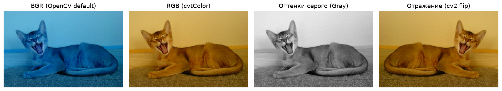
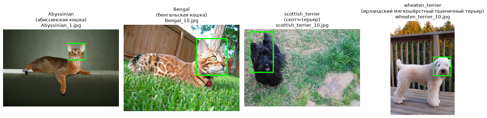

# Лабораторная 1: Среда, репозиторий и первый взгляд на данные

**Студент:** Кныш Радион Николаевич  
**Группа:** 4 курс  
**Вариант:** 10  

## 1. Задача

Развернуть рабочее окружение, исследовать структуру и форматы датасета Oxford-IIIT Pet для варианта 10, освоить базовые операции с изображениями как многомерными массивами NumPy в OpenCV/Pillow и сформировать сводку характеристик данных и разметки.

## 2. Как запустить

Работа протестирована локально (Python 3.11 на Windows), а также полностью совместима с Kaggle и Google Colab. В ноутбуке уже предустановлен `VARIANT = 10`.

### Локальный запуск:
```bash
# 1. Перейти в корень репозитория
cd cv-2026-knysh

# 2. Создать и активировать виртуальное окружение
python -m venv .venv
# Windows (PowerShell): .venv\Scripts\Activate.ps1
# Windows (CMD):        .venv\Scripts\activate.bat
# Linux / macOS:        source .venv/bin/activate

# 3. Установить зависимости
pip install -r requirements.txt

# 4. Открыть ноутбук lab01/solution.ipynb и выполнить Run All:
jupyter notebook lab01/solution.ipynb
```
*Примечание:* Данные варианта (архив `variant_10.zip` ~83 МБ) автоматически скачиваются и распаковываются первой ячейкой ноутбука в папку `data/variant_10/`. В коде нет абсолютных путей.

### Запуск в Google Colab / Kaggle:
1. Загрузите файл `lab01/solution.ipynb` в Colab (File → Open notebook → GitHub / Upload) или Kaggle (File → Import Notebook).
2. В Kaggle в правой панели включите **Internet: On** (Settings → Internet).
3. Нажмите **Run All** (все ячейки выполняются автоматически без правок).

## 3. Данные

Вариант **10** датасета Oxford-IIIT Pet (версия `v1`):
- Всего изображений: **798**
- Разметка XML с боксами голов: **397**
- Маски сегментации (trimap): **798**
- Породы в варианте (2 кошки + 2 собаки):
  1. `Abyssinian` (абиссинская кошка, `cat`) — 199 изображений, 99 боксов, 199 trimap.
  2. `Bengal` (бенгальская кошка, `cat`) — 200 изображений, 98 боксов, 200 trimap.
  3. `scottish_terrier` (скотч-терьер, `dog`) — 199 изображений, 100 боксов, 199 trimap.
  4. `wheaten_terrier` (ирландский мягкошёрстный пшеничный терьер, `dog`) — 200 изображений, 100 боксов, 200 trimap.
- Сложная пара (hard pair): `Abyssinian` и `Bengal` (CV error: 0.0426).
- Битых или нечитаемых файлов нет, отброшенных файлов нет.

## 4. Результаты

Сводные метрики из файла [`results/summary.csv`](results/summary.csv):

| Метрика | Описание | Значение |
| :--- | :--- | ---: |
| `variant` | Номер варианта | 10 |
| `n_files` | Общее количество файлов изображений | 798 |
| `n_breeds` | Количество пород | 4 |
| `n_cats` | Количество изображений кошек | 399 |
| `n_dogs` | Количество изображений собак | 399 |
| `min_width` | Минимальная ширина изображения, px | 150 |
| `median_width` | Медианная ширина изображения, px | 500.0 |
| `max_width` | Максимальная ширина изображения, px | 1646 |
| `min_height` | Минимальная высота изображения, px | 116 |
| `median_height` | Медианная высота изображения, px | 375.0 |
| `max_height` | Максимальная высота изображения, px | 1600 |
| `n_non_rgb` | Количество файлов с режимом не `RGB` | 1 |
| `n_non_jpeg` | Количество файлов с форматом не `JPEG` | 1 |
| `n_with_xml` | Количество файлов с XML-разметкой бокса головы | 397 |

### Преобразования изображения (BGR, RGB, Gray, Flip):


### Примеры пород с детекционной разметкой (бокс головы):


## 5. Выводы

1. **Цветовые каналы BGR vs RGB в OpenCV**: При чтении через `cv2.imread` OpenCV использует порядок каналов BGR (для центрального пикселя `Abyssinian_155.jpg` получено значение `[B=0, G=74, R=130]`). При прямом выводе в Matplotlib без `cv2.cvtColor(bgr, cv2.COLOR_BGR2RGB)` рыжая шерсть абиссинской кошки отображается синей, так как компоненты синего (0) и красного (130) инвертируются.
2. **Проблемные файлы и скрытый альфа-канал**: В датасете обнаружен ровно 1 файл из 798 с форматом не JPEG и режимом не RGB — это `Abyssinian_5.jpg` (формат `PNG`, 4-канальный режим `RGBA`). Функция `cv2.imread` по умолчанию скрывает дефект, приводя изображение к 3 каналам `(150, 200, 3)`, тогда как `cv2.imread(..., cv2.IMREAD_UNCHANGED)` считывает все 4 канала `(150, 200, 4)`. Если передать такой файл без предобработки в модель глубокого обучения, возникнет ошибка несовпадения размерностей тензора.
3. **Идеальный баланс видов и равномерность классов**: Данные безупречно сбалансированы по видам: ровно 399 кошек и 399 собак (соотношение 1:1). По породам разброс минимален: по 200 изображений у Bengal и wheaten_terrier и по 199 у Abyssinian и scottish_terrier (отношение 200 / 199 ≈ 1.005), что исключает дисбаланс классов при обучении классификатора.
4. **Существенный геометрический разброс кадров**: Ширина кадров варьируется от 150 до 1646 px (медиана 500.0 px), а высота — от 116 до 1600 px (медиана 375.0 px). Простое масштабирование `cv2.resize(rgb, (224, 224))` без паддинга (letterboxing) приведет к сильным геометрическим деформациям пропорций животных для сильно вытянутых кадров.
5. **Покрытие разметкой**: XML-разметка бокса головы в формате Pascal VOC присутствует ровно у 397 файлов из 798 (49.75% выборки), при этом маски `trimap` (значения 1 — животное, 2 — фон, 3 — граница) доступны для всех 798 изображений (100%).
