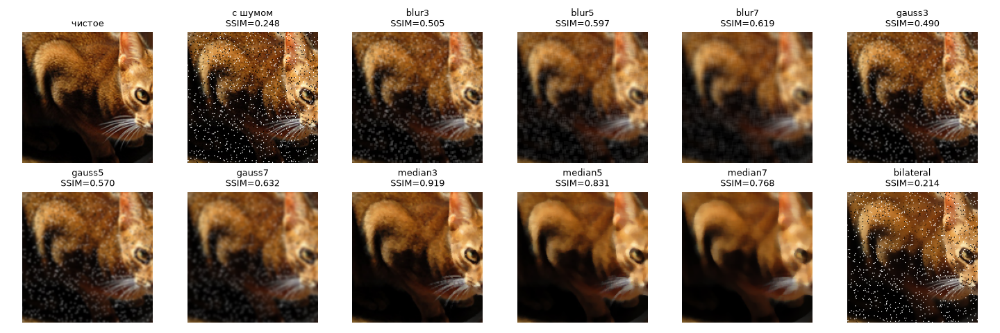
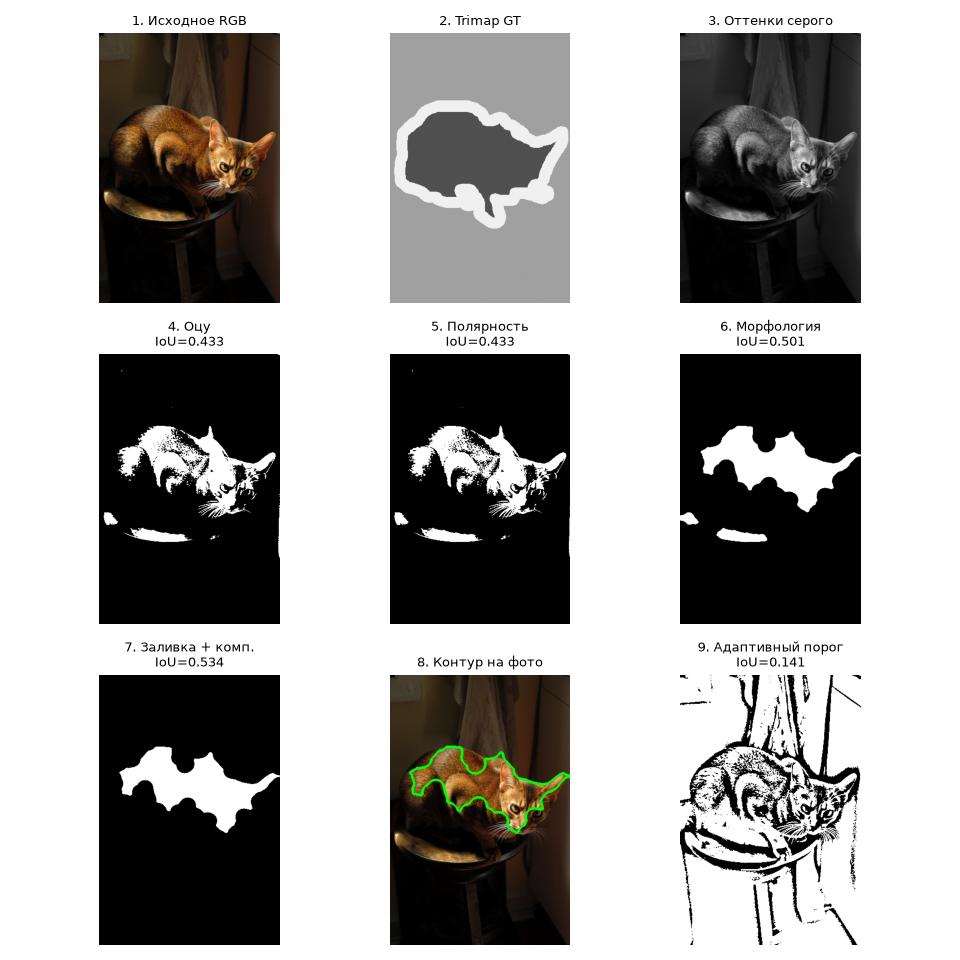
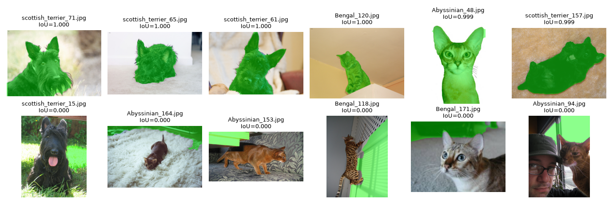

# Лабораторная 2: Классическая обработка изображений

**Студент:** Кныш Радион Николаевич  
**Группа:** 4 курс  
**Вариант:** 10  

## 1. Задача

Исследовать статистические характеристики освещённости, контраста, шума и резкости датасета Oxford-IIIT Pet; оценить методы коррекции освещённости и шумоподавления на синтетическом шуме; реализовать классический пайплайн сегментации животного без нейросетей (Оцу, морфология, связные компоненты) и проанализировать морфологические признаки формы масок.

## 2. Как запустить

Ноутбук протестирован локально в Python 3.11 (Windows) и полностью готов к запуску в Google Colab и Kaggle. В коде нет абсолютных путей, а первая ячейка автоматически загружает вариант 10.

```bash
# 1. Перейти в корень репозитория
cd cv-2026-knysh

# 2. Активировать виртуальное окружение
# Windows (PowerShell): .venv\Scripts\Activate.ps1
# Windows (CMD):        .venv\Scripts\activate.bat
# Linux / macOS:        source .venv/bin/activate

# 3. Установить зависимости
pip install -r requirements.txt

# 4. Запустить ноутбук
jupyter notebook lab02/solution.ipynb
```
*Для запуска в Google Colab / Kaggle:* откройте `lab02/solution.ipynb` (в Kaggle включите `Internet: On` в правой панели Settings) и нажмите **Run All**.

## 3. Данные

- **Вариант:** 10 (всего 798 изображений Oxford-IIIT Pet v1).
- **Породы:** `Abyssinian` (199 фото), `Bengal` (200 фото), `scottish_terrier` (199 фото), `wheaten_terrier` (200 фото).
- **Синтетический шум варианта:** импульсный шум «соль и перец» (`kind = "sp"`, доля зашумлённых пикселей `amount = 0.08` из таблицы `NOISE_PLAN`).

## 4. Результаты

### Главные числовые метрики

| Метрика / Параметр | Значение | Описание |
| :--- | :---: | :--- |
| **Шум варианта** | `sp (amount=0.08)` | Импульсный шум «соль и перец» |
| **Качество без фильтра** | PSNR: **15.91 дБ**, SSIM: **0.248** | Исходный зашумлённый кадр |
| **Лучший фильтр (`BEST_FILTER`)** | **`median3`** | Медианный фильтр с ядром 3×3 |
| **Качество лучшего фильтра** | PSNR: **33.94 дБ**, SSIM: **0.919** | Прирост: +18.03 дБ, +0.671 SSIM |
| **Время лучшего фильтра** | **0.18 мс** | В 6 раз быстрее `median5`, в 40 раз быстрее `bilateral` |
| **Выбранный канал (`CHANNEL`)** | **`gray`** | Оттенки серого (mean IoU: 0.473) |
| **IoU: только Оцу (шаг 1)** | mean: **0.220**, median: **0.136** | Базовый глобальный порог Оцу |
| **IoU: итоговый пайплайн (шаг 5)** | mean: **0.473**, median: **0.447** | Прирост IoU: **+0.253** (+115%) |

---

### Сравнение фильтров шумоподавления (`filters.png`)
На кропах центра кадра видно, как линейные фильтры (`blur`, `gauss`) размазывают черные и белые точки в серые пятна, `bilateral` сохраняет точки шума, а медианный фильтр устраняет их целиком:


---

### Пошаговый пайплайн сегментации одного кадра (`pipeline.png`)
Пошаговая трансформация: серое → порог Оцу → инверсия полярности → морфология → заливка дыр и выделение крупнейшей компоненты → контур:


---

### Лучшие и худшие маски по IoU (`best_worst.png`)
В верхней строке приведены 6 лучших сегментаций (четкий силуэт, высокий контраст с фоном), в нижней — 6 худших масок (слияние текстуры животного с фоном):


---

## 5. Выводы

### Часть 1. Освещённость, шум и фильтры

1. **Победа медианной фильтрации на импульсном шуме**: На шуме «соль и перец» (`amount = 0.08`) победителем стал фильтр `median3`, показав рекордные **PSNR = 33.94 дБ** и **SSIM = 0.919**. Он опередил занявший второе место `median5` (PSNR = 30.77 дБ, SSIM = 0.831) на **+3.17 дБ** и **+0.088 SSIM**, так как меньшее ядро 3×3 не размывает тонкие детали шерсти. Победители по обеим метрикам полностью совпали.
2. **Провал билатерального фильтра и вычислительная сложность**: Фильтр `median3` работает всего **0.18 мс** на кадр, что почти в 40 раз быстрее `bilateral` (7.06 мс) и в 90 раз быстрее `median7` (16.47 мс). Билатеральный фильтр на импульсном шуме показал катастрофический результат (**SSIM = 0.214**, что даже ниже зашумленного кадра 0.248), поскольку алгоритм принимает изолированные выбросы соли и перца за высокочастотные перепады границ и старательно сохраняет их.
3. **Искажение цветопередачи при эквализации RGB**: При обработке 5 самых тёмных фото эквализация по независимым каналам RGB (`eq_rgb`) привела к колоссальному сдвигу цвета **$\Delta col = 20.42$** (при среднем $mean\_L = 132.0$). Для сравнения, выравнивание только канала яркости `eq_L` дало сдвиг **0.71**, а адаптивный `clahe_L` — всего **0.45**. Независимое растяжение гистограмм каналов R, G, B грубо нарушает баланс белого и приводит к неестественным цветовым артефактам.
4. **Разброс освещённости и резкости по породам**: Самой тёмной породой оказалась `Abyssinian` (средняя яркость $mean\_L = 117.03$ против $124.47$ у `Bengal`). Самой резкой породой стал `scottish_terrier` ($sharpness = 857.26$ против $317.78$ у `Abyssinian`), что объясняется жесткой фактурной черной шерстью скотч-терьера, дающей выраженные градиенты на лапласиане.

### Часть 2. Выделение животного и признаки формы

5. **Вклад этапов пайплайна (аблация)**: Базовый порог Оцу дает среднюю IoU всего **0.220**. Решающий прирост качества дала коррекция полярности по краям кадра — скачок до **0.420** (+0.200 IoU), поскольку на большинстве фото светлый фон оказывается ярче животного. Морфологические операции (открытие/закрытие) подняли IoU до **0.452** (+0.032), а заливка дыр и выделение крупнейшей компоненты обеспечили итоговую среднюю IoU **0.473** (медиана **0.447**).
6. **Сравнение каналов и анализ ошибок**: Канал `gray` показал наилучший баланс устойчивости (mean IoU **0.473**), опередив насыщенность `S` (0.417) и хроматическую компоненту `a` (0.377). Среди пород наивысшая точность достигнута на `scottish_terrier` (**IoU = 0.558** благодаря высокому контрасту темного силуэта), а худшая — на `wheaten_terrier` (**IoU = 0.417**). Худшие кадры (IoU = 0.000) возникают при слиянии цвета шерсти пшеничного терьера или кошек с песочным/деревянным фоном или ковром.
