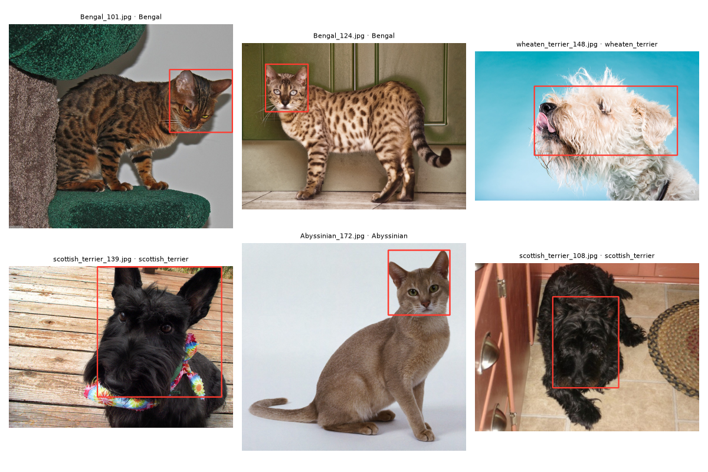
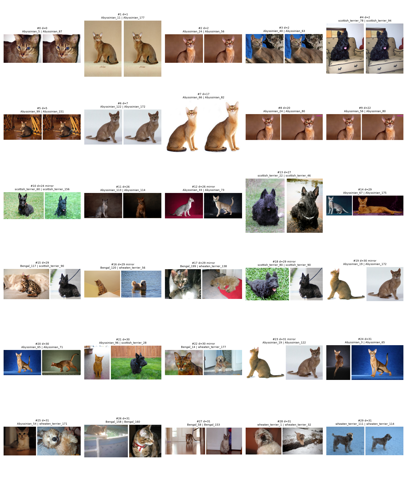
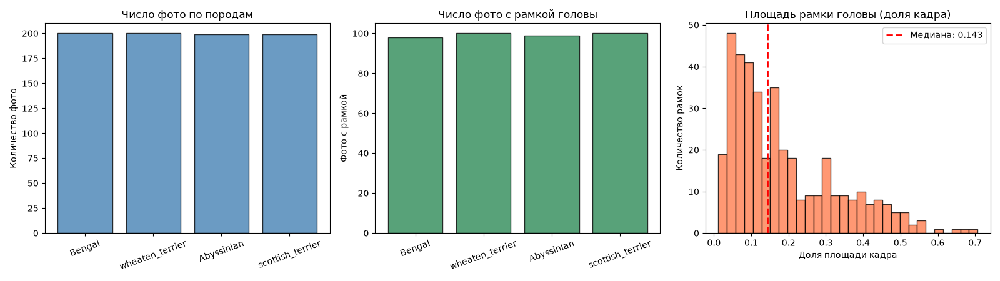
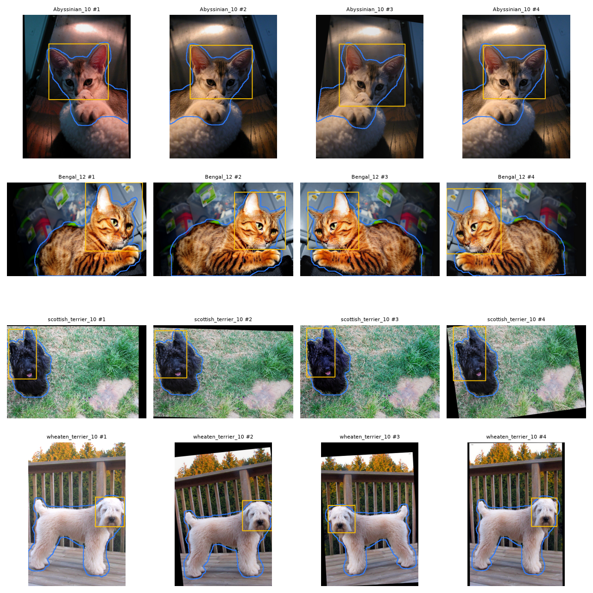
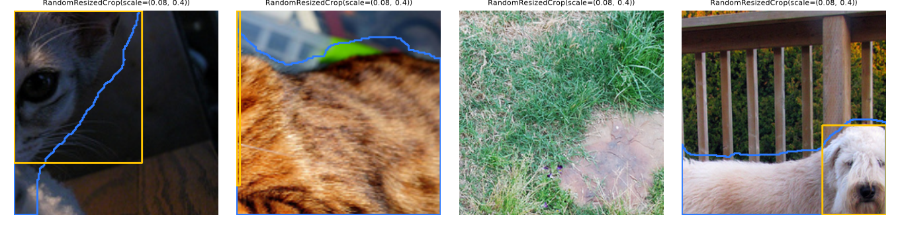

# Лабораторная 3: Данные: разметка, дубликаты, честное разбиение, аугментации

**Вариант:** 10

## 1. Задача

Провести аудит исходных аннотаций датасета (XML Pascal VOC и Trimap), конвертировать разметку в форматы COCO и YOLO, выявить дубликаты и серийные кадры с помощью перцептивных хэшей, выполнить стратифицированное групповое разбиение без утечек данных, а также протестировать влияние аугментаций на целостность объектов.

## 2. Как запустить

Ноутбук протестирован и выполнен локально в среде Python 3.11. Ноутбук полностью автономен и может выполняться на Kaggle или Colab (первая ячейка автоматически определяет среду и при необходимости загружает архив данных варианта).

```bash
# Установка зависимостей
pip install -r ../requirements.txt

# Откройте lab03/solution.ipynb, убедитесь, что VARIANT = 10, и нажмите «Run All»
```

## 3. Данные

- **Номер варианта:** 10
- **Породы:** кошки: `Abyssinian` (199 фото), `Bengal` (200 фото); собаки: `scottish_terrier` (199 фото), `wheaten_terrier` (200 фото).
- **Трудная пара:** `Abyssinian` и `Bengal` (обе породы короткошёрстных пятнисто-полосатых кошек с близкой морфологией головы).
- **Объём данных:** 798 фотографий, из них 397 снабжены XML-разметкой ограничивающих рамок головы (Pascal VOC), 797 имеют корректную маску сегментации (Trimap).
- **Обработка границы trimap (`BORDER_AS = "animal"`):** Значение пикселей границы 3 в тримапе объединено с классом животного (1), так как граница содержит тонкие анатомические элементы (усы, шерсть на контурах ушей и лап). Их отнесение к фону приводит к эрозии маски и искусственной потере мелких деталей при векторизации в полигоны.

## 4. Результаты

### Сводные показатели

| Метрика / Параметр | Значение |
| :--- | ---: |
| Всего изображений в датасете | 798 |
| Изображений с XML-рамками головы | 397 (49.7%) |
| Найдено аномалий разметки при аудите | 3 |
| — Формат/каналы (`Abyssinian_5.jpg`) | PNG / RGBA (4 канала) |
| — Количество рамок (`Bengal_105.jpg`) | 2 рамки (вместо 1) |
| — Пустая маска (`wheaten_terrier_195.jpg`) | Trimap пуста (нет объекта) |
| Ошибка конвертации VOC $\to$ YOLO $\to$ VOC | 0.000 px |
| IoU маски при переводе маска $\to$ полигон $\to$ маска (медиана / минимум) | 0.9958 / 0.9563 |
| Медианная доля площади рамки головы от кадра (`box_area_frac`) | 0.1429 (14.29%) |
| Доля рамок менее 5% площади кадра | 0.1184 (11.84%, 47 фото) |
| Минимальный линейный размер стороны рамки | 30 px |
| Кандидатов в пары дубликатов (хэш-дистанция $\le 32$) | 30 пар |
| Разметка пар: дубликаты (`same`) / серии (`series`) / разные (`different`) | 9 / 6 / 15 |
| Число групп связанных кадров (2+ фото) / число фото в группах | 11 групп / 24 фото |
| Случайное разбиение 70/15/15: среднее число разорванных групп | 5.68 из 11 (51.6%) |
| Случайное разбиение: утечка кадров между train и test | 2.80 групп (25.5%) |
| Групповое разбиение (StratifiedGroupKFold): разорванных групп | 0 (0.0%) |
| Размер выборки Train (всего фото / с рамкой / с маской) | 570 (71.4%) / 280 / 570 |
| Размер выборки Val (всего фото / с рамкой / с маской) | 114 (14.3%) / 53 / 114 |
| Размер выборки Test (всего фото / с рамкой / с маской) | 114 (14.3%) / 64 / 113 |
| Баланс пород в Train / Val / Test (мин. доля / макс. доля породы) | 24.6% / 25.4% |
| Аугментация `RandomResizedCrop(scale=(0.08, 0.4))`: выход головы за кадр | 0.1869 (18.7%) |
| `RandomResizedCrop`: видно менее половины площади головы (IoU < 0.5) | 0.6398 (64.0%) |

### Иллюстрации результатов

#### Проверка форматов и обратной конвертации


#### Кандидаты в дубликаты и серии по перцептивным хэшам


#### Распределение геометрических параметров рамок голов


#### Безопасный пайплайн аугментаций (для обучения классификатора и детектора)


#### Анализ разрушительной аугментации (RandomResizedCrop)


## 5. Выводы

1. **Аудит разметки и очистка данных (Часть 1):** Из 798 файлов выборки детальный аудит выявил ровно 3 дефекта (0.38% объема): файл `Abyssinian_5.jpg` сохранён как 4-канальный PNG/RGBA (требует конвертации в 3-канальный RGB перед подачей в нейросеть), `Bengal_105.jpg` содержит 2 рамки голов на одном кадре (обе кошки валидны и сохранены в аннотациях детекции), а `wheaten_terrier_195.jpg` имеет полностью пустой тримап (маска сегментации отсутствует). Для сохранения корректности обучения данный файл исключён из полигонов COCO сегментации, но сохранён для классификации.
2. **Точность конвертации в COCO и YOLO (Часть 1):** Прямая и обратная конвертация рамок между Pascal VOC и YOLO дает максимальное расхождение 0.000 px, подтверждая абсолютную обратимость нормализации координат. Векторизация тримапов в контуры COCO алгоритмом `cv2.findContours` с аппроксимацией `approxPolyDP` обеспечивает медианный IoU растровой и полигональной масок 0.9958 (минимум 0.9563). Небольшое отклонение от единицы вызвано естественным сглаживанием единичных пикселей шерсти, при этом 99.6% площади маски сохраняется без избыточного раздувания JSON-файла сотнями микро-вершин.
3. **Хэширование и распределение масштабов (Часть 1):** Анализ распределения показал, что медианная доля площади головы животного составляет 14.29% от кадра, а 11.84% рамок (47 штук) имеют площадь менее 5% кадра с минимальным размером 30 px. Поиск по перцептивным хэшам pHash и dHash с порогом $\le 32$ выявил 30 пар-кандидатов: 9 признаны точными дубликатами (`same`, дистанция хэша 0–22, различия в сжатии или масштабе), 6 — сериями фото одного животного (`series`, дистанция 17–31). Оставшиеся 15 пар (`different`, дистанция 24–31) являются ложными срабатываниями хэша из-за однородного светлого студийного фона и центрированной посадки разных кошек пород `Abyssinian` и `Bengal`.
4. **Утечки при случайном разбиении против Stratified Group Split (Часть 2):** 15 связанных пар сформировали 11 групп из 24 снимков. Наивное случайное разбиение 70/15/15 разрывает в среднем 5.68 из 11 групп (51.6%), допуская попадание одинаковых кадров одной фотосессии одновременно в train и test в среднем для 2.80 групп (25.5%). Это привело бы к искусственно оптимистичной оценке обобщающей способности модели (data leakage). Разбиение с помощью `StratifiedGroupKFold` гарантировало 0 разорванных групп и 0 межвыборочных утечек при идеальном балансе 4 классов: доли пород во всех выборках составляют от 24.6% до 25.4% (в train 570 фото, в val 114 фото, в test 114 фото).
5. **Влияние пространственных аугментаций (Часть 2):** Эксперимент с агрессивным случайным кадрированием `RandomResizedCrop(scale=(0.08, 0.4))` показал, что в 18.69% случаев голова животного полностью срезается за пределы видимого поля, а в 63.98% случаев остаётся видимой менее чем наполовину. Подача таких срезанных фрагментов без фильтрации порождает «фантомные» рамки и дезинформирует детектор. Для последующих лабораторных работ сформирован безопасный пайплайн (`HorizontalFlip`, `RandomBrightnessContrast`, умеренный `ShiftScaleRotate`), который не нарушает видимость ключевых частей тела и гарантирует валидность разметки.

### Обоснование группировки и метода разбиения

Группой в данной работе считается компонента связности графа изображений датасета, вершинами которого являются фотографии, а рёбрами — установленные связи `same` (дубликаты исходного кадра с различиями в цветокоррекции, сжатии или кадрировании) и `series` (серийная съёмка одного конкретного питомца в одной фотосессии с одного ракурса с интервалом в секунды). Такие снимки содержат идентичный фон, текстуру шерсти и освещение. Если одно фото попадёт в обучающую выборку, а другое — в тестовую, нейросеть сможет безошибочно «угадать» класс по контексту окружения, не научившись генерализовать признаки породы. Для предотвращения этой утечки применено групповое стратифицированное разбиение `StratifiedGroupKFold`: оно неделимо переносит каждую группу целиком строго в один сплит, одновременно поддерживая равное представительство каждого из 4 классов в обучающей, валидационной и тестовой выборках.
